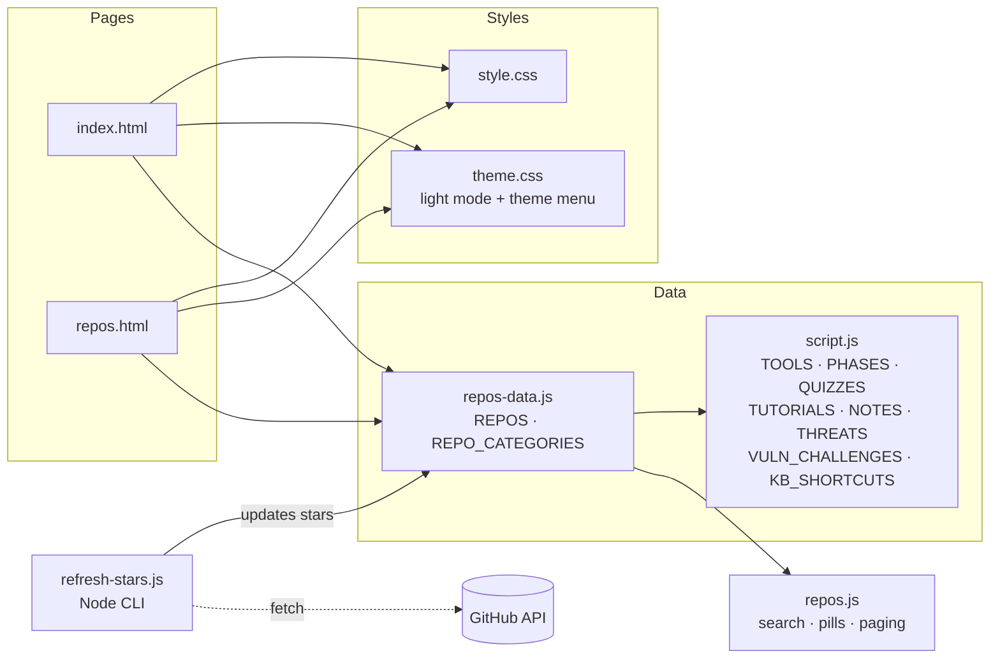

<div align="center">

```
███████╗███████╗ ██████╗  ██████╗██╗███████╗████████╗██╗   ██╗
██╔════╝██╔════╝██╔═══██╗██╔════╝██║██╔════╝╚══██╔══╝╚██╗ ██╔╝
█████╗  ███████╗██║   ██║██║     ██║█████╗     ██║    ╚████╔╝
██╔══╝  ╚════██║██║   ██║██║     ██║██╔══╝     ██║     ╚██╔╝
██║     ███████║╚██████╔╝╚██████╗██║███████╗   ██║      ██║
╚═╝     ╚══════╝ ╚═════╝  ╚═════╝╚═╝╚══════╝   ╚═╝      ╚═╝
                    // a r m a n x p l o i t s
```

### `WE ARE FSOCIETY` — break · learn · secure

*An offensive-security field log you can actually click through.*

[](https://fsociety-web.vercel.app)
[](#-tech-stack)
[](#-boot-it-locally)
[](#-rules-of-engagement)

**[⟶ enter the node](https://fsociety-web.vercel.app)** &nbsp;·&nbsp; **[⟶ the arsenal](https://fsociety-web.vercel.app/repos.html)** &nbsp;·&nbsp; **[⟶ report a bug](https://github.com/arman080325/fsociety-web/issues)**

</div>

> *"Hello, friend. Hello, friend? That's lame. Maybe I should give you a name."*
> — Elliot Alderson

---

```console
armanxploits@fsociety:~$ cat /etc/motd
```

**fsociety-web** is the public hub of **Arman Ahemad Khan** ([@armanxploits](https://github.com/arman080325)) —
a 4th-year CS engineering student, cybersecurity intern and pentester-in-progress running a Kali box.

It isn't a stunt and it isn't a template. It is a **working field log**: a quiz-gated career roadmap,
step-by-step lab tutorials, a filterable arsenal, browser-side hacking utilities, a code-review
vulnerability game, animated attack trees and a 67-repo community index — all wrapped in a
Mr. Robot–inspired operator aesthetic and shipped as **plain HTML, CSS and vanilla JS**. No framework,
no bundler, no `npm install`.

> [!IMPORTANT]
> Everything here is **educational**. Every technique assumes a lab you own or an engagement you are
> contracted for. *Written authorisation. Always. No exceptions.*

---

## ▸ Table of contents

| | | |
|---|---|---|
| [`00` Boot it locally](#-boot-it-locally) | [`05` The arsenal page](#-the-arsenal-page-reposhtml) | [`10` Repo map](#-repo-map) |
| [`01` The tour](#-the-tour--12-sections-one-page) | [`06` Look & feel](#-look--feel) | [`11` Hacking Stuffs vault](#-hacking-stuffs--the-notes-vault) |
| [`02` Interactive systems](#-interactive-systems) | [`07` Keyboard ops](#-keyboard-ops) | [`12` Deploy](#-deploy) |
| [`03` Toolbox](#-toolbox--runs-100-in-your-browser) | [`08` Under the hood](#-under-the-hood) | [`13` Rules of engagement](#-rules-of-engagement) |
| [`04` Spot the vulnerability](#-spot-the-vulnerability) | [`09` Modding guide](#-modding-guide) | [`14` Roadmap](#-whats-next) |

---

## ▸ Boot it locally

```bash
git clone https://github.com/arman080325/fsociety-web.git
cd fsociety-web
python3 -m http.server 8080        # → http://localhost:8080
```

Any static server works (`npx serve .`, `caddy file-server`, VS Code Live Server on port `5501` —
already configured in `.vscode/settings.json`). You can also just double-click `index.html`.

> [!TIP]
> Serve it over HTTP rather than `file://` if you want the boot sound and GitHub card images on the
> arsenal page to behave consistently across browsers.

---

## ▸ The tour — 12 sections, one page

Before the page even opens you get the **boot sequence**: the fsociety mask rendered in ASCII,
a typed-out terminal handshake and a `[ skip ]` button. After that, a **live threat ticker** of
real CVEs scrolls along the bottom edge and a gradient **scroll-progress bar** tracks you along the top.

| `//` | Section | What's inside |
|:---:|---|---|
| — | **hero** | `WE ARE FSOCIETY` glitch title, a particle-network canvas, drifting orbs, scanline sweep, a self-typing `armanxploits@fsociety:~` terminal and count-up stats |
| `01` | **whoami** | ID card, animated skill meters (Web App, Network, Wireless, Exploitation, OSINT) and the *fsociety box* hardware spec sheet |
| `02` | **the path** | Interactive career roadmap — phases `00 → 05`, 26 nodes, clickable dossiers, quiz-gated clearance, progress saved locally |
| `03` | **tutorials** | Tabbed walkthroughs across Recon & OSINT, Web Exploitation, Wireless, PrivEsc, Social Engineering and Forensics |
| `04` | **arsenal** | 28 tools filterable by `recon` · `exploitation` · `wireless` · `web` · `misc`, each tagged *configured*, *live* or *learning* |
| `05` | **toolbox** | Five utilities that run entirely client-side — see [Toolbox](#-toolbox--runs-100-in-your-browser) |
| `06` | **spot the vulnerability** | A 12-round code-review game — find the planted bug, read the fix |
| `07` | **attack tree** | Animated top-down SVG kill chains for **Web App**, **Network** and **Wireless** scenarios |
| `08` | **journey** | A 2021 → now timeline: first Kali dual-boot, XSS Game, Bettercap, Burp Pro, the Obsidian vault, the internship |
| `09` | **field notes** | Seven tabbed cheat-sheets: MitM with Bettercap, WPA2 handshake capture, web pentest methodology, Nmap discovery, Linux PrivEsc, social engineering, digital forensics |
| `10` | **proving ground** | Lab progress cards — PortSwigger Academy, Google XSS Game (6/6), TryHackMe, HackTheBox |
| `11` | **repos** | Personal repos plus the top featured community repos, with a jump to the full arsenal page |
| `12` | **contact** | Links out, plus a `contact.sh` widget that pings the node and paints the mask in ASCII |

---

## ▸ Interactive systems

<details open>
<summary><b>◈ the path — a career rendered as an attack chain</b></summary>
<br>

The roadmap treats a security career like an engagement: you start at recon and work toward operator.

| Phase | Title | Nodes |
|:---:|---|:---:|
| `00` | Recon — Foundations | 4 |
| `01` | Foothold — Core Security | 3 |
| `02` | Escalation — Offensive Skills | 6 |
| `03` | Proving Ground — Practice | 4 |
| `04` | Credentials — Certs | 5 |
| `05` | Operator — Career | 4 |

- **Dossiers** — tap a node and a side panel slides in with what it is, why it matters, the topics to cover and curated resources.
- **Knowledge checks** — every one of the 26 nodes has a multiple-choice question. Answer correctly to *mark as cleared*; get it wrong and you get the explanation instead.
- **Clearance meter** — your percentage climbs as nodes clear. Filter by track (foundations · offensive · practice · credentials) or wipe it with *reset progress*.
- **Persistence** — progress lives in `localStorage` under `fsoc_cleared_v1`. Nothing leaves your browser.

</details>

<details>
<summary><b>⬡ tutorials — real commands, scope warnings included</b></summary>
<br>

Each tutorial has a difficulty badge (`beg` / `int` / `adv`), numbered steps with copy-to-clipboard
code blocks, tags, and a scope warning. Category tab counts update automatically from the data.

| Category | Examples |
|---|---|
| Recon & OSINT | Nmap Full Recon Workflow · Subdomain Enumeration · Shodan Recon & OSINT |
| Web Exploitation | XSS Hunting — Reflected & DOM · SQL Injection — Manual to sqlmap · SSRF |
| Wireless | WPA2 Handshake Capture & Crack · Deauth Attack & Evil Twin Setup |
| Privilege Escalation | Linux PrivEsc — Full Checklist · Windows PrivEsc — Checklist |
| Social Engineering | Phishing Campaign Setup (awareness / authorised simulations) |
| Forensics | Incident Response — First Responder |

</details>

<details>
<summary><b>◉ attack tree — kill chains you can watch draw</b></summary>
<br>

Pick a scenario and the tree builds itself top-down: cubic-Bézier SVG paths animate in via
`stroke-dashoffset` while nodes fade and rise in sequence. Click any node to inspect it.

| Colour | Meaning |
|---|---|
| 🔴 `#ff2d2d` | Root / target |
| 🟠 `#ff9900` | Phase header |
| 🔵 `#00e5ff` | Recon / discovery |
| 🟣 `#bf5fff` | Exploitation technique |
| 🟢 `#39ff7e` | Impact / objective achieved |

</details>

---

## ▸ Toolbox — runs 100% in your browser

No server, no API keys, no telemetry. Paste, click, done.

| Tool | Does |
|---|---|
| **⌘ Payload Encoder** | Base64 encode/decode, URL encode/decode, → hex, HTML entities — plus copy-output |
| **# Hash Identifier** | Guesses the hash family from its length and format — CRC-32, MySQL/DES, MD5/NTLM/MD4, SHA-1, SHA-224, SHA-256/BLAKE2, SHA-384, SHA-512 — ready for the matching Hashcat `-m` mode |
| **⚡ CVE Lookup** | Searches a local DB of 13 high-impact CVEs by ID or keyword — Log4Shell, EternalBlue, Spring4Shell, regreSSHion, PAN-OS, ScreenConnect and more — with a link to NVD |
| **.\* Regex Tester** | Live pattern + flags with highlighted matches |
| **◈ Ports Reference** | 16 ports that matter on an engagement — 21, 22, 23, 25, 53, 80, 139, 443, 445, 1433, 3306, 3389, 5985, 6379, 8080, 27017 — with pentest notes |

---

## ▸ Spot the vulnerability

Twelve short, realistic snippets with one planted flaw each. Choose the vulnerability class, get the
reasoning and the fix, keep score. The order shuffles on every visit.

```
SQL Injection · Reflected XSS · Command Injection · Path Traversal · IDOR / Broken Access Control
SSRF · Hardcoded Credentials · CSRF · XXE · Insecure Deserialization · Open Redirect · Broken Auth
```

Snippets span **PHP, Node/Express, Python/Flask, Java/Spring, JavaScript and HTML**.

---

## ▸ The arsenal page (`repos.html`)

A second page, linked from *repos → show all tools ↗*, titled **THE ARSENAL**.

- **67 community security repos** across **55 categories** — Active Directory, C2, cloud, DFIR, evasion, exploit dev, OSINT, wireless, automotive/CAN, Bluetooth and more.
- **Instant search** over names, owners and descriptions, plus **category pills with live counts**.
- **Cards pulled from GitHub's OpenGraph images**, with an initials fallback if an image fails.
- **Chunked rendering** — 30 cards at a time with *load more*.
- **One source of truth** — `repos-data.js` feeds both this page and the three *featured* repos on the home page.

### Keep star counts fresh

```bash
node refresh-stars.js --dry          # preview, write nothing
node refresh-stars.js                # update repos-data.js (makes a .bak)
GITHUB_TOKEN=ghp_xxx node refresh-stars.js   # 5000 req/hr instead of 60
```

The script only touches the `stars:` numbers — descriptions, categories and `featured` flags are left
alone. Needs Node 18+. **Never commit the token** (`.env` and `*.token` are already git-ignored).

---

## ▸ Look & feel

### Three themes, zero flash

A dropdown in the nav switches between **☾ dark · ☀ light · ⊙ system**. An inline script in `<head>`
reads `fsoc_theme` from `localStorage` *before* first paint, so there's no flash of the wrong theme.
In light mode the terminals and code blocks **stay dark** — a real terminal on a light desk.

### Palette

| Token | Hex | Role |
|---|---|---|
| `--signal` | `#ff2d2d` | Primary red — titles, alerts, root nodes |
| `--phosphor` | `#39ff7e` | Terminal green — live and cleared states |
| `--cyan` | `#00e5ff` | Secondary accents, recon |
| `--purple` | `#bf5fff` | Exploitation nodes |
| `--ember` | `#ff9900` | Warnings, phase headers |
| `--yellow` | `#ffe600` | Highlights |
| `--bone` | `#e8e4d9` | Body text |
| `--panel` | `#111114` | Cards |
| `--void` | `#080809` | The background, the abyss |

### Type

**Archivo** (900) for display headings · **JetBrains Mono** for everything that should feel like a shell.

### Atmosphere

Film grain, CRT scanlines and a vignette layered over the whole page; a Mr. Robot–style cursor trail
that bursts glitch characters on click; particle pops as section headers scroll in; a periodic glitch
on the hero title; and an fsociety entry sound that starts quietly on your first click or keypress.
`prefers-reduced-motion` is respected.

### Responsive

Tuned from ultrawide down to phone width: burger nav, wrapping tabs, cards that shrink to the
viewport and a ports table that scrolls inside its card instead of breaking the page.

---

## ▸ Keyboard ops

| Keys | Action |
|---|---|
| <kbd>?</kbd> | Open the shortcuts panel |
| <kbd>Esc</kbd> | Close any panel |
| <kbd>G</kbd> <kbd>H</kbd> | Hero |
| <kbd>G</kbd> <kbd>W</kbd> | whoami |
| <kbd>G</kbd> <kbd>R</kbd> | Roadmap |
| <kbd>G</kbd> <kbd>T</kbd> | Tutorials |
| <kbd>G</kbd> <kbd>A</kbd> | Arsenal |
| <kbd>G</kbd> <kbd>X</kbd> | Toolbox |
| <kbd>G</kbd> <kbd>N</kbd> | Field notes |
| <kbd>G</kbd> <kbd>C</kbd> | Contact |

On mobile, open the burger menu and tap **⌨ shortcuts**.

---

## ▸ Under the hood



`script.js` is split into a **data layer** at the top (plain arrays and objects) and a set of
self-contained **IIFE modules** below it — boot, hero terminal, network canvas, ticker, renderers,
roadmap, dossier, toolbox, shortcuts, cursor trail, scroll bar, attack tree, sound, theme and the
vuln game. Change the data and the UI follows.

| Effect | How it's done |
|---|---|
| Boot sequence | Timed `innerHTML` writes over an ASCII mask, skippable |
| Network canvas | Proximity-linked particles on `<canvas>`, `requestAnimationFrame` |
| Scroll reveal & counters | `IntersectionObserver` adds `.in`; counters tick up with rAF |
| Threat ticker | CSS `tickerRun` keyframes on a duplicated track |
| Attack tree | SVG Bézier paths + `strokeDashoffset`, nodes staggered with `setTimeout` |
| Cursor trail | Full-screen canvas particle system on `mousemove` / `click` |
| Theme | `data-theme` on `<html>`, CSS custom-property swap in `theme.css` |

---

## ▸ Modding guide

Fork it, then edit the data — no build step to re-run.

<details>
<summary><b>Add a tool to the arsenal</b> — <code>script.js → TOOLS</code></summary>

```js
TOOLS.push({
  n:  "Bloodhound",                // name
  c:  "recon",                     // recon | exploit | web | wireless | misc
  d:  "AD relationship graphing.", // description
  t:  "AD",                        // tag
  s:  "learn",                     // ok | live | learn  (status colour)
  st: "learning",                  // status text
});
```
</details>

<details>
<summary><b>Add a roadmap node with a knowledge check</b> — <code>PHASES</code> + <code>QUIZZES</code></summary>

```js
PHASES[2].nodes.push({
  id: "ad", label: "Active Directory", track: "off",   // found | off | practice | career
  blurb: "Where enterprise networks actually fall.",
  why: "Most internal engagements end in AD — learn how trust is abused.",
  topics: ["Kerberos", "Kerberoasting", "BloodHound"],
  res: [{ n: "HackTricks — AD", u: "https://book.hacktricks.xyz" }],
});

QUIZZES.ad = {
  q: "Which attack requests service tickets to crack them offline?",
  options: ["Pass-the-Hash", "Kerberoasting", "DCSync", "Golden Ticket"],
  correct: 1,
  explain: "Kerberoasting requests TGS tickets for SPN accounts and cracks them offline.",
};
```
</details>

<details>
<summary><b>Add a tutorial</b> — <code>TUTORIALS.&lt;cat&gt;</code></summary>

```js
TUTORIALS.webpwn.push({
  title: "IDOR — Insecure Direct Object Reference",
  diff: "int",                                   // beg | int | adv
  desc: "Finding broken access control in authorised labs.",
  steps: [{ h: "Enumerate IDs", p: "Swap your ID for another.", code: "curl -s http://lab.local/api/user/2" }],
  tags: ["IDOR", "Burp", "PortSwigger"],
  warn: "Lab or authorised targets only.",
});
```
Categories: `recon` · `webpwn` · `wireless` · `privesc` · `social` · `forensics`
</details>

<details>
<summary><b>Add a field note</b> — <code>NOTES</code></summary>

```js
NOTES.ad = {
  title: "// Active Directory",
  meta: "enumeration checklist · 2026",
  secs: [{ h: "First look", list: ["whoami /all", "net group \"Domain Admins\" /domain"] }],
};
```
Tabs are generated from `NOTES`, so the new category appears automatically.
</details>

<details>
<summary><b>Add a vuln-hunt challenge</b> — <code>VULN_CHALLENGES</code></summary>

```js
VULN_CHALLENGES.push({
  lang: "Go",
  code: `http.Redirect(w, r, r.URL.Query().Get("next"), 302)`,
  options: ["Open Redirect", "SSRF", "XSS", "CSRF"],
  correct: 0,
  explain: "Untrusted `next` goes straight into a redirect. Allow-list destinations.",
});
```
</details>

<details>
<summary><b>Add an attack-tree scenario</b> — <code>TREES</code> inside the top-down attack-tree IIFE</summary>

```js
TREES.ad = {
  label: "Active Directory Attack Chain",
  root: { id: "root", label: "AD ENVIRONMENT", sub: "authorised engagement", color: "#ff2d2d",
    children: [{ id: "enum", label: "ENUMERATION", sub: "bloodhound · ldap", color: "#ff9900",
      children: [{ id: "kerb", label: "Kerberoasting", sub: "GetUserSPNs.py", color: "#bf5fff",
        children: [{ id: "crack", label: "Offline crack", sub: "hashcat -m 13100", color: "#39ff7e", children: [] }] }] }] },
};
```
```html
<button class="atree-btn" data-tree="ad">◈ Active Directory</button>
```
</details>

<details>
<summary><b>Add a community repo</b> — <code>repos-data.js → REPOS</code></summary>

```js
{
  owner: "BloodHoundAD", repo: "BloodHound",
  lang: "TypeScript", stars: 9000,     // a number — formatted automatically
  featured: false,                     // true → one of the 3 cards on the home page
  cats: ["ad", "recon"],               // ids from REPO_CATEGORIES
  desc: "Six degrees of Domain Admin.",
},
```
Then run `node refresh-stars.js` to pull the real star count.
</details>

<details>
<summary><b>Ticker, shortcuts, stats, contact</b></summary>

- **Threat ticker** → `THREATS` (`sev: "crit" | "high" | "med"`)
- **Shortcuts** → `KB_SHORTCUTS` for the panel, `NAV_MAP` in the keyboard IIFE for the <kbd>G</kbd> jumps
- **Hero stats** → `.hero-stats` in `index.html` (`data-to` is the number it counts up to)
- **Journey / proving ground / contact** → static HTML in `index.html`
- **Boot sound** → swap `fsociety_enter.mp3`; volume and loop live in the sound IIFE
</details>

---

## ▸ Repo map

```
fsociety-web/
├── index.html            ← the main node — all 12 sections
├── repos.html            ← THE ARSENAL — searchable community repo index
├── style.css             ← core styles, components, animations, breakpoints
├── theme.css             ← light mode + dark/light/system dropdown
├── script.js             ← data layer + every interactive module
├── repos-data.js         ← REPOS + REPO_CATEGORIES (shared by both pages)
├── repos.js              ← arsenal page: search, pills, paging, card fallbacks
├── refresh-stars.js      ← Node CLI — sync star counts from the GitHub API
├── fsociety_enter.mp3    ← entry sound
├── favicons/             ← current icon set + boot ASCII art (40 / 56 col)
├── old favicons/         ← previous icon set, kept for reference
├── Hacking Stuffs/       ← Markdown notes vault (see below)
└── .vscode/settings.json ← Live Server on :5501
```

---

## ▸ Hacking Stuffs — the notes vault

Long-form Markdown study notes that sit alongside the site.

| Topic | File |
|---|---|
| 🗺 90-day hacking roadmap | [`90_Days_Hacking_Roadmap.md`](Hacking%20Stuffs/90_Days_Hacking_Roadmap.md) |
| 🌐 TCP/IP & OSI for hackers | [`TCPIP_OSI_Model_Hacker_Guide_README.md`](Hacking%20Stuffs/TCPIP_OSI_Model_Hacker_Guide_README.md) |
| 🔎 18 info-gathering tools | [`18_InfoGatheringTools.md`](Hacking%20Stuffs/18_InfoGatheringTools.md) |
| 🎯 Red team recon | [`README_Red_Team_Recon.md`](Hacking%20Stuffs/README_Red_Team_Recon.md) |
| 📡 Network analysis & packet sniffing | [`README_Network_Analysis_and_Packet_Sniffing.md`](Hacking%20Stuffs/README_Network_Analysis_and_Packet_Sniffing.md) |
| 🐍 Netcat in Python | [`README_Netcat_Python_Educational.md`](Hacking%20Stuffs/README_Netcat_Python_Educational.md) |
| 🕸 Web application security concepts | [`README_Web_Application_Security_Concepts.md`](Hacking%20Stuffs/README_Web_Application_Security_Concepts.md) |
| 💉 XSS — comprehensive | [`README_XSS_Comprehensive.md`](Hacking%20Stuffs/README_XSS_Comprehensive.md) |
| 🍪 Session hijacking | [`Session_Hijacking_README.md`](Hacking%20Stuffs/Session_Hijacking_README.md) |
| 🔑 Bypassing password reset (pt. 1) | [`Bypassing Your Password Reset Readme.md`](Hacking%20Stuffs/Bypassing%20Your%20Password%20Reset%20Readme.md) |
| 🔑 Bypassing password reset (pt. 2) | [`Bypassing Your Password Reset Readme 2.md`](Hacking%20Stuffs/Bypassing%20Your%20Password%20Reset%20Readme%202.md) |
| 💰 Bug bounty hunting tools | [`Bug_Bounty_Hunting_Tools_README.md`](Hacking%20Stuffs/Bug_Bounty_Hunting_Tools_README.md) |
| 📶 Wireless network security | [`README_Wireless_Network_Security.md`](Hacking%20Stuffs/README_Wireless_Network_Security.md) |
| 🦷 Bluetooth tracking & hacking | [`Bluetooth_Tracking_Hacking_README.md`](Hacking%20Stuffs/Bluetooth_Tracking_Hacking_README.md) |
| 📱 Android hacking | [`Android-Hacking.md`](Hacking%20Stuffs/Android-Hacking.md) |
| 🚗 Car hacking & vehicle security | [`README_Car_Hacking_and_Vehicle_Security.md`](Hacking%20Stuffs/README_Car_Hacking_and_Vehicle_Security.md) |

---

## ▸ Tech stack

| Layer | Choice |
|---|---|
| Markup | Semantic HTML5 — two pages, no framework |
| Styling | CSS3 custom properties, Grid, Flexbox, keyframes, `data-theme` theming |
| Logic | Vanilla ES6+ in IIFE modules — zero runtime dependencies |
| Graphics | `<canvas>` particle systems, animated inline SVG |
| Fonts | Archivo + JetBrains Mono via Google Fonts |
| Storage | `localStorage` — roadmap progress (`fsoc_cleared_v1`) and theme (`fsoc_theme`) only |
| Tooling | One optional Node 18+ script (`refresh-stars.js`) |
| Hosting | Vercel — any static host works |

---

## ▸ Deploy

**Vercel** (current) — import the repo, framework preset *Other*, no build command, output directory `/`.
Every push to `main` redeploys.

**GitHub Pages** — *Settings → Pages → Deploy from branch → `main` / root*.

**Netlify** — drag the folder onto [app.netlify.com/drop](https://app.netlify.com/drop), or connect the repo.

**Anywhere else** — it's static files. `nginx`, `caddy`, an S3 bucket, a Raspberry Pi under your desk.

---

## ▸ Rules of engagement

The difference between a pentester and a problem is a signature on a scope document.

| Target | In scope? |
|---|---|
| PortSwigger Web Security Academy | ✅ Built for it |
| DVWA, bWAPP, VulnHub, Metasploitable | ✅ Self-hosted — yours |
| TryHackMe, HackTheBox | ✅ Their boxes, their rules |
| Your own network and hardware | ✅ Your call |
| A bug-bounty program | ⚠️ Only what its policy lists |
| Anyone else's systems | ❌ **Not without written permission** |

Nothing on this site is a manual for attacking people who didn't agree to it. If you're unsure whether
something is in scope, it isn't.

---

## ▸ What's next

- [x] Dark / light / system theme
- [x] Spot-the-vulnerability code-review game
- [x] Quiz-gated roadmap clearance
- [x] Standalone searchable arsenal page
- [x] Full mobile responsiveness pass
- [ ] Active Directory attack tree
- [ ] Expandable CTF write-up cards
- [ ] Full interactive quiz section beyond the roadmap checks
- [ ] Bug-bounty hall of fame
- [ ] Live threat feed (CISA KEV / NVD) to replace the static ticker
- [ ] Auto-import field notes from the Obsidian vault

---

## ▸ Contribute

Found a broken link, a wrong command or an outdated CVE? [Open an issue](https://github.com/arman080325/fsociety-web/issues)
or send a PR. Tool and repo suggestions are welcome — add them to `TOOLS` or `repos-data.js` and
explain why they earn a slot.

## ▸ Connect

| | |
|---|---|
| ⬡ GitHub | [github.com/arman080325](https://github.com/arman080325) |
| ◈ LinkedIn | [linkedin.com/in/arman-ahemad-khan](https://www.linkedin.com/in/arman-ahemad-khan) |
| ◉ Mail | [armanxploit@gmail.com](mailto:armanxploit@gmail.com) |

Open to CTF teams, bug-bounty collabs and security research.

## ▸ License

Built for learning. Fork it, gut it, make it yours — credit appreciated, not required.
Don't use it to do anything illegal.

Inspired by the aesthetics of *Mr. Robot*. Not affiliated with USA Network, NBCUniversal or the show's
creators. All trademarks belong to their owners.

---

<div align="center">

```console
armanxploits@fsociety:~$ ping armanxploits
PING armanxploits — 56 bytes
64 bytes: icmp_seq=1 ttl=64 time=0.1ms
--- node is REACHABLE ---
armanxploits@fsociety:~$ exit
```

**ARMANXPLOITS // fsociety** · break · learn · secure

<sub>educational use only · ethical hacking is legal hacking · always get written permission</sub>

</div>
