<!--
  ███ fsociety-web // README ███
  Every panel below is a hand-built animated SVG living in assets/readme/.
  No external image services, no tracking pixels, no JS. Just CSS keyframes inside SVG.
-->

<p align="center">
  <a href="https://fsociety-web.vercel.app">
    
  </a>
</p>

<p align="center">
  
</p>

<p align="center">
  <a href="https://fsociety-web.vercel.app"></a>
  <a href="https://fsociety-web.vercel.app/repos.html"></a>
  <a href="#-12"></a>
  <a href="#-13"></a>
</p>

<p align="center">
  <code>hello, friend.</code><br>
  <sub>you found the source of <b>fsociety-web</b> — the field log of <a href="https://github.com/arman080325"><b>@armanxploits</b></a>,<br>
  a 4th-year CS engineer, cybersecurity intern and pentester-in-progress, running a Kali box and learning offence the hard way.</sub>
</p>

<p align="center">
  <a href="https://fsociety-web.vercel.app"><b>▸ enter the node</b></a> &nbsp;│&nbsp;
  <a href="https://fsociety-web.vercel.app/repos.html"><b>▸ the arsenal</b></a> &nbsp;│&nbsp;
  <a href="#-00"><b>▸ boot locally</b></a> &nbsp;│&nbsp;
  <a href="#-10"><b>▸ mod it</b></a> &nbsp;│&nbsp;
  <a href="https://github.com/arman080325/fsociety-web/issues"><b>▸ report a bug</b></a>
</p>

<br>

<a id="-00"></a>

<p align="center">
  
</p>

No framework. No bundler. No `npm install`. Three commands and you're in:

```bash
git clone https://github.com/arman080325/fsociety-web.git && cd fsociety-web
python3 -m http.server 8080
# → http://localhost:8080   (or VS Code Live Server — already pinned to :5501)
```

<p align="center">
  
</p>

<br>

<a id="-01"></a>

<p align="center">
  
</p>

> Before any of that, the page **boots**: the fsociety mask is drawn in ASCII, a terminal handshake types
> itself out, and you can `[ skip ]`. A **CVE ticker** runs along the bottom edge, a gradient
> **progress bar** tracks your scroll, and the cursor leaves a **glitch trail** that bursts on click.

<details>
<summary><b>▸ <code>cat sections.log</code> — what each module actually does</b></summary>
<br>

| `//` | module | payload |
|:--:|---|---|
| `01` | **whoami** | ID card · animated skill meters (web, network, wireless, exploitation, OSINT) · *fsociety box* spec sheet |
| `02` | **the path** | career roadmap as a kill chain — phases `00 → 05`, 26 nodes, dossier side-panels, quiz-gated clearance |
| `03` | **tutorials** | 12 walkthroughs across recon, web, wireless, privesc, social engineering and forensics — commands + scope warnings |
| `04` | **arsenal** | 28 tools, filterable, each tagged `configured` · `live` · `learning` |
| `05` | **toolbox** | five utilities that run entirely in your browser |
| `06` | **vuln hunt** | 12-round code-review game, shuffled every visit |
| `07` | **attack tree** | animated SVG kill chains — web app · network · wireless |
| `08` | **journey** | 2021 → now: first Kali dual-boot → XSS Game → Bettercap → Burp Pro → Obsidian vault → internship |
| `09` | **field notes** | 7 tabbed cheat-sheets: MitM, WPA2, web methodology, recon, Linux privesc, social eng, forensics |
| `10` | **proving ground** | PortSwigger Academy · Google XSS Game (6/6) · TryHackMe · HackTheBox |
| `11` | **repos** | personal tools + the three featured community repos |
| `12` | **contact** | links out + a `contact.sh` widget that pings the node |

</details>

<br>

<a id="-02"></a>

<p align="center">
  
</p>

A career mapped like an engagement. Tap a node → a **dossier** slides in: what it is, why a pentester needs it,
topics to cover, where to learn it. Then comes the gate: **every node has a knowledge check**. Answer right and the node
clears and your **clearance level** climbs. Answer wrong and you get the explanation instead of the badge.

```diff
+ 00 RECON ........... foundations ....... networking · linux · windows · scripting
+ 01 FOOTHOLD ........ core security ..... security principles · cryptography · web fundamentals
+ 02 ESCALATION ...... offensive skills .. web app · network · active directory · wireless · privesc · OSINT
+ 03 PROVING GROUND .. practice .......... PortSwigger labs · TryHackMe · HackTheBox · CTFs
+ 04 CREDENTIALS ..... certs ............. Security+ · eJPT · PNPT · OSCP · BSCP
+ 05 OPERATOR ........ career ............ reporting · bug bounty · red teaming · specialise
- progress → localStorage["fsoc_cleared_v1"] — it never leaves your browser
```

<br>

<a id="-03"></a>

<p align="center">
  
</p>

<sub>☝ that's the <b>web app</b> chain, drawn the same way the site does it: Bézier edges animate in on <code>stroke-dashoffset</code>,
nodes rise level by level, and packets travel the links. On the site you can also switch to <b>network</b> and <b>wireless</b>
and click any node to inspect it.</sub>

<br><br>

<a id="-04"></a>

<table>
<tr>
<td width="50%" valign="top">

**`⌘` payload encoder**<br>
<sub>base64 ⇄ · URL ⇄ · → hex · HTML entities · one-click copy</sub>

**`#` hash identifier**<br>
<sub>reads length + format → CRC-32, MySQL/DES, MD5/NTLM/MD4, SHA-1, SHA-224/256/384/512 — pick your Hashcat <code>-m</code></sub>

**`.*` regex tester**<br>
<sub>live pattern + flags, matches highlighted as you type</sub>

</td>
<td width="50%" valign="top">

**`⚡` CVE lookup**<br>
<sub>local DB of 13 heavy hitters — Log4Shell, EternalBlue, Spring4Shell, regreSSHion, PAN-OS, ScreenConnect, TeamCity… → NVD</sub>

**`◈` ports reference**<br>
<sub><code>21 22 23 25 53 80 139 443 445 1433 3306 3389 5985 6379 8080 27017</code> — each with pentest notes</sub>

**`∅` network calls**<br>
<sub>none. Everything runs client-side. Nothing you paste goes anywhere.</sub>

</td>
</tr>
</table>

<br>

<a id="-05"></a>

The site serves 12 snippets, each with **one planted flaw**: SQLi, XSS, command injection, path traversal, IDOR, SSRF,
hardcoded creds, CSRF, XXE, insecure deserialization, open redirect and broken auth, across PHP, Node, Python/Flask,
Java/Spring and HTML. Here's one from the deck. **Try it before you open the answer.**

```python
# challenge 03 / 12 — Python
filename = request.args.get('file')
os.system("cat " + filename)
```

<details>
<summary><b>▸ <code>./reveal --answer</code></b></summary>
<br>

> **Command injection.** `?file=x; id` runs both commands because user input is concatenated straight into a shell call.<br>
> **Fix:** never hand user input to a shell. Read the file with `open()` after validating the path against an allow-list,
> or use `subprocess.run([...], shell=False)`.

The other eleven are waiting on the [live site](https://fsociety-web.vercel.app/#vulnhunt). 🔒

</details>

<br>

<a id="-06"></a>

[`repos.html`](https://fsociety-web.vercel.app/repos.html) is a second page: **THE ARSENAL**. It holds **67 community security repos** across
**55 categories**: Active Directory, C2, cloud, DFIR, evasion, exploit dev, OSINT, wireless, automotive/CAN, Bluetooth and more.

```text
⌕ instant search ── owners · names · descriptions
◉ category pills ── with live counts, empty ones hidden
▣ card images ───── pulled from GitHub OpenGraph, initials fallback if they fail
▾ load more ─────── renders 30 at a time
★ star sync ─────── refresh-stars.js (below)
```

`repos-data.js` is the single source of truth. It feeds this page *and* the three featured cards on the home page. Keep star counts honest:

```bash
node refresh-stars.js --dry                     # preview the diff, write nothing
node refresh-stars.js                           # rewrite stars:, keep a .bak
GITHUB_TOKEN=ghp_xxx node refresh-stars.js      # 5000 req/hr instead of 60 — never commit it
```

<br>

<a id="-07"></a>

<p align="center">
  
</p>

| layer | what you see |
|---|---|
| **atmosphere** | film grain · CRT scanlines · vignette · drifting orbs · a particle network on `<canvas>` |
| **motion** | periodic title glitch · particle pops as sections reveal · count-up stats · a Mr. Robot–style cursor trail |
| **sound** | an fsociety entry loop that starts quietly on your first click or keypress |
| **themes** | `☾ dark` · `☀ light` · `⊙ system`, applied *before first paint* from `localStorage["fsoc_theme"]` so there's no flash. In light mode the terminals stay dark: a real terminal on a light desk |
| **type** | **Archivo 900** for the shouting · **JetBrains Mono** for everything that should feel like a shell |
| **reach** | ultrawide → phone · burger nav · wrapping tabs · in-card scrolling tables · `prefers-reduced-motion` respected |

<br>

<a id="-08"></a>

<p align="center">
<kbd>?</kbd> panel &nbsp; <kbd>Esc</kbd> close &nbsp;│&nbsp;
<kbd>G</kbd><kbd>H</kbd> hero &nbsp; <kbd>G</kbd><kbd>W</kbd> whoami &nbsp; <kbd>G</kbd><kbd>R</kbd> roadmap &nbsp; <kbd>G</kbd><kbd>T</kbd> tutorials<br>
<kbd>G</kbd><kbd>A</kbd> arsenal &nbsp; <kbd>G</kbd><kbd>X</kbd> toolbox &nbsp; <kbd>G</kbd><kbd>N</kbd> field notes &nbsp; <kbd>G</kbd><kbd>C</kbd> contact
<br><sub>on a phone: burger menu → <b>⌨ shortcuts</b></sub>
</p>

<br>

<a id="-09"></a>


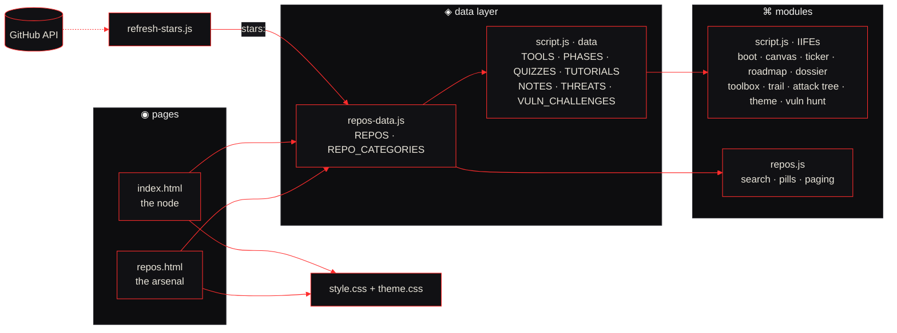

`script.js` = a **data layer** on top (plain arrays and objects) + self-contained **IIFE modules** below.
Edit the data and the UI follows. Under the effects: `requestAnimationFrame` canvases, `IntersectionObserver` reveals,
SVG `strokeDashoffset` drawing, CSS keyframes, and `data-theme` token swaps.

<br>

<a id="-10"></a>

Fork it, then edit the data. There's nothing to rebuild.

<details>
<summary><b>⬡ add a tool</b> → <code>TOOLS</code></summary>

```js
TOOLS.push({ n: "BloodHound", c: "recon", d: "AD relationship graphing.", t: "AD", s: "learn", st: "learning" });
//            name            recon|exploit|web|wireless|misc            tag      ok|live|learn  label
```
</details>

<details>
<summary><b>◈ add a roadmap node + its knowledge check</b> → <code>PHASES</code> + <code>QUIZZES</code></summary>

```js
PHASES[2].nodes.push({
  id: "cloud", label: "Cloud Security", track: "off",        // found | off | practice | career
  blurb: "Where the crown jewels moved.",
  why: "Misconfigured IAM and metadata endpoints are today's open doors.",
  topics: ["IAM", "S3 misconfig", "IMDS / SSRF"],
  res: [{ n: "flAWS challenge", u: "http://flaws.cloud" }],
});
QUIZZES.cloud = {
  q: "Which IP serves the AWS instance metadata service?",
  options: ["10.0.0.1", "169.254.169.254", "127.0.0.53", "192.168.0.254"],
  correct: 1,
  explain: "IMDS lives at 169.254.169.254 — a favourite SSRF target for stealing role credentials.",
};
```
</details>

<details>
<summary><b>▶ add a tutorial</b> → <code>TUTORIALS.&lt;recon|webpwn|wireless|privesc|social|forensics&gt;</code></summary>

```js
TUTORIALS.webpwn.push({
  title: "IDOR — Insecure Direct Object Reference", diff: "int",   // beg | int | adv
  desc: "Finding broken access control in authorised labs.",
  steps: [{ h: "Swap the ID", p: "Request another user's object.", code: "curl -s http://lab.local/api/user/2" }],
  tags: ["IDOR", "Burp"], warn: "Lab or authorised targets only.",
});
```
Tab counts update automatically.
</details>

<details>
<summary><b>✎ add a field note</b> → <code>NOTES</code></summary>

```js
NOTES.ad = { title: "// Active Directory", meta: "enum checklist · 2026",
  secs: [{ h: "First look", list: ["whoami /all", "net group \"Domain Admins\" /domain"] }] };
```
Tabs are generated from `NOTES`, so the new one appears on its own.
</details>

<details>
<summary><b>⚠ add a vuln-hunt round</b> → <code>VULN_CHALLENGES</code></summary>

```js
VULN_CHALLENGES.push({ lang: "Go", code: `http.Redirect(w, r, r.URL.Query().Get("next"), 302)`,
  options: ["Open Redirect", "SSRF", "XSS", "CSRF"], correct: 0,
  explain: "Untrusted `next` goes straight into a redirect. Allow-list destinations." });
```
</details>

<details>
<summary><b>△ add an attack-tree scenario</b> → <code>TREES</code> (top-down attack tree IIFE)</summary>

```js
TREES.ad = { label: "Active Directory Attack Chain",
  root: { id: "root", label: "AD ENVIRONMENT", sub: "authorised engagement", color: "#ff2d2d", children: [
    { id: "enum", label: "ENUMERATION", sub: "bloodhound · ldap", color: "#ff9900", children: [
      { id: "kerb", label: "Kerberoasting", sub: "GetUserSPNs.py", color: "#bf5fff", children: [
        { id: "crack", label: "Offline crack", sub: "hashcat -m 13100", color: "#39ff7e", children: [] } ] } ] } ] } };
```
```html
<button class="atree-btn" data-tree="ad">◈ Active Directory</button>
```
</details>

<details>
<summary><b>★ add a community repo</b> → <code>repos-data.js</code></summary>

```js
{ owner: "BloodHoundAD", repo: "BloodHound", lang: "TypeScript", stars: 9000,
  featured: false,            // true → one of the 3 cards on the home page
  cats: ["ad", "recon"],      // ids from REPO_CATEGORIES
  desc: "Six degrees of Domain Admin." },
```
</details>

<details>
<summary><b>⚙ the rest</b></summary>

`THREATS` → ticker (`crit` · `high` · `med`) &nbsp;·&nbsp; `KB_SHORTCUTS` + `NAV_MAP` → keyboard ops &nbsp;·&nbsp;
`.hero-stats[data-to]` → count-ups &nbsp;·&nbsp; journey / proving / contact → static HTML in `index.html` &nbsp;·&nbsp;
`fsociety_enter.mp3` → the entry sound
</details>

<br>

<a id="-11"></a>

`Hacking Stuffs/` is a Markdown study vault that lives alongside the site. **16 files**, open the drawer:

<details>
<summary><b>▸ <code>ls -la "Hacking Stuffs/"</code></b></summary>
<br>

| | file | |
|---|---|---|
| 🗺 | [90-day hacking roadmap](Hacking%20Stuffs/90_Days_Hacking_Roadmap.md) | start here |
| 🌐 | [TCP/IP & OSI — hacker's guide](Hacking%20Stuffs/TCPIP_OSI_Model_Hacker_Guide_README.md) | foundations |
| 🔎 | [18 info-gathering tools](Hacking%20Stuffs/18_InfoGatheringTools.md) | recon |
| 🎯 | [red team recon](Hacking%20Stuffs/README_Red_Team_Recon.md) | recon |
| 📡 | [network analysis & packet sniffing](Hacking%20Stuffs/README_Network_Analysis_and_Packet_Sniffing.md) | network |
| 🐍 | [netcat in Python](Hacking%20Stuffs/README_Netcat_Python_Educational.md) | tooling |
| 🕸 | [web application security concepts](Hacking%20Stuffs/README_Web_Application_Security_Concepts.md) | web |
| 💉 | [XSS — comprehensive](Hacking%20Stuffs/README_XSS_Comprehensive.md) | web |
| 🍪 | [session hijacking](Hacking%20Stuffs/Session_Hijacking_README.md) | web |
| 🔑 | [bypassing password reset · pt 1](Hacking%20Stuffs/Bypassing%20Your%20Password%20Reset%20Readme.md) | web |
| 🔑 | [bypassing password reset · pt 2](Hacking%20Stuffs/Bypassing%20Your%20Password%20Reset%20Readme%202.md) | web |
| 💰 | [bug bounty hunting tools](Hacking%20Stuffs/Bug_Bounty_Hunting_Tools_README.md) | bounty |
| 📶 | [wireless network security](Hacking%20Stuffs/README_Wireless_Network_Security.md) | wireless |
| 🦷 | [bluetooth tracking & hacking](Hacking%20Stuffs/Bluetooth_Tracking_Hacking_README.md) | wireless |
| 📱 | [android hacking](Hacking%20Stuffs/Android-Hacking.md) | mobile |
| 🚗 | [car hacking & vehicle security](Hacking%20Stuffs/README_Car_Hacking_and_Vehicle_Security.md) | hardware |

</details>

```text
fsociety-web/
├── index.html          the node — 12 sections
├── repos.html          THE ARSENAL
├── style.css           core styles · components · animation · breakpoints
├── theme.css           light mode + ☾ ☀ ⊙ dropdown
├── script.js           data layer + every interactive module
├── repos-data.js       REPOS + REPO_CATEGORIES (shared by both pages)
├── repos.js            search · pills · paging · image fallbacks
├── refresh-stars.js    node CLI — sync stars from the GitHub API
├── fsociety_enter.mp3  the entry sound
├── favicons/           icon set + boot ASCII mask (40 / 56 col)
├── assets/readme/      the animated SVGs on this page
└── Hacking Stuffs/     the vault
```

<br>

<a id="-12"></a>

It's static files, so it runs anywhere.

| target | how |
|---|---|
| **Vercel** *(live)* | import repo → preset *Other* → no build command → output `/` → every push to `main` ships |
| **GitHub Pages** | *Settings → Pages → Deploy from branch → `main` / root* |
| **Netlify** | drag the folder onto [app.netlify.com/drop](https://app.netlify.com/drop) |
| **anywhere** | `nginx` · `caddy file-server` · `npx serve .` · an S3 bucket · a Pi under your desk |

<br>

<a id="-13"></a>

> [!CAUTION]
> **The difference between a pentester and a problem is a signature on a scope document.**
> Everything here is educational and assumes a lab you own or an engagement you're contracted for.

```diff
+ PortSwigger Web Security Academy ........ built for it
+ DVWA · bWAPP · VulnHub · Metasploitable . self-hosted, yours
+ TryHackMe · HackTheBox .................. their boxes, their rules
+ your own network & hardware ............. your call
! a bug-bounty program .................... only what its policy lists
- anyone else's systems ................... NOT without written permission
```

<sub>If you're unsure whether something is in scope, it isn't.</sub>

<br>

<a id="-14"></a>

```diff
+ [x] dark / light / system theme
+ [x] spot-the-vulnerability code-review game
+ [x] quiz-gated roadmap clearance
+ [x] standalone searchable arsenal page
+ [x] full mobile responsiveness pass
- [ ] active directory attack tree
- [ ] expandable CTF write-up cards
- [ ] full interactive quiz section
- [ ] bug-bounty hall of fame
- [ ] live threat feed (CISA KEV / NVD) instead of the static ticker
- [ ] auto-import field notes from the Obsidian vault
```

Found a dead link, a wrong flag or a stale CVE? [Open an issue](https://github.com/arman080325/fsociety-web/issues) or send a PR.
If you think a tool deserves a slot, add it to `TOOLS` or `repos-data.js` and explain why.

<br>

<a id="-15"></a>

<p align="center">
  <a href="https://github.com/arman080325"></a>
  <a href="https://www.linkedin.com/in/arman-ahemad-khan"></a>
  <a href="mailto:armanxploit@gmail.com"></a>
</p>

<p align="center"><sub>open to CTF teams · bug-bounty collabs · security research</sub></p>

<p align="center">
  
</p>

<p align="center">
<sub>
built for learning — fork it, gut it, make it yours. credit appreciated, not required. don't use it for anything illegal.<br>
aesthetic inspired by <i>Mr. Robot</i>; not affiliated with USA Network, NBCUniversal or the show's creators.
</sub>
</p>
